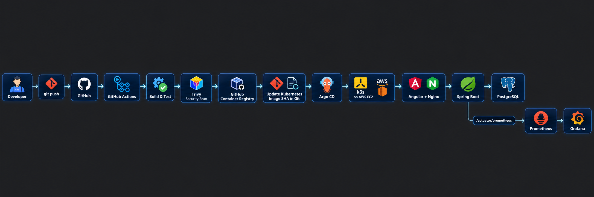
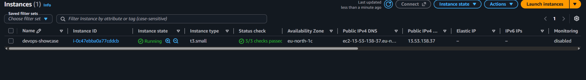
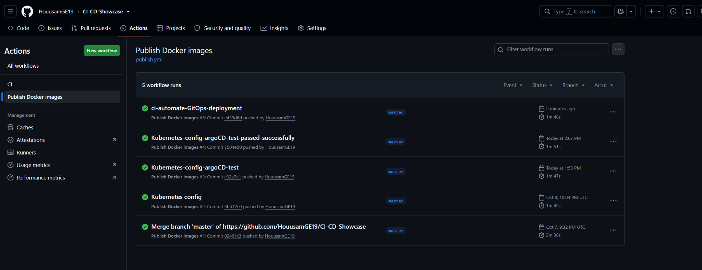
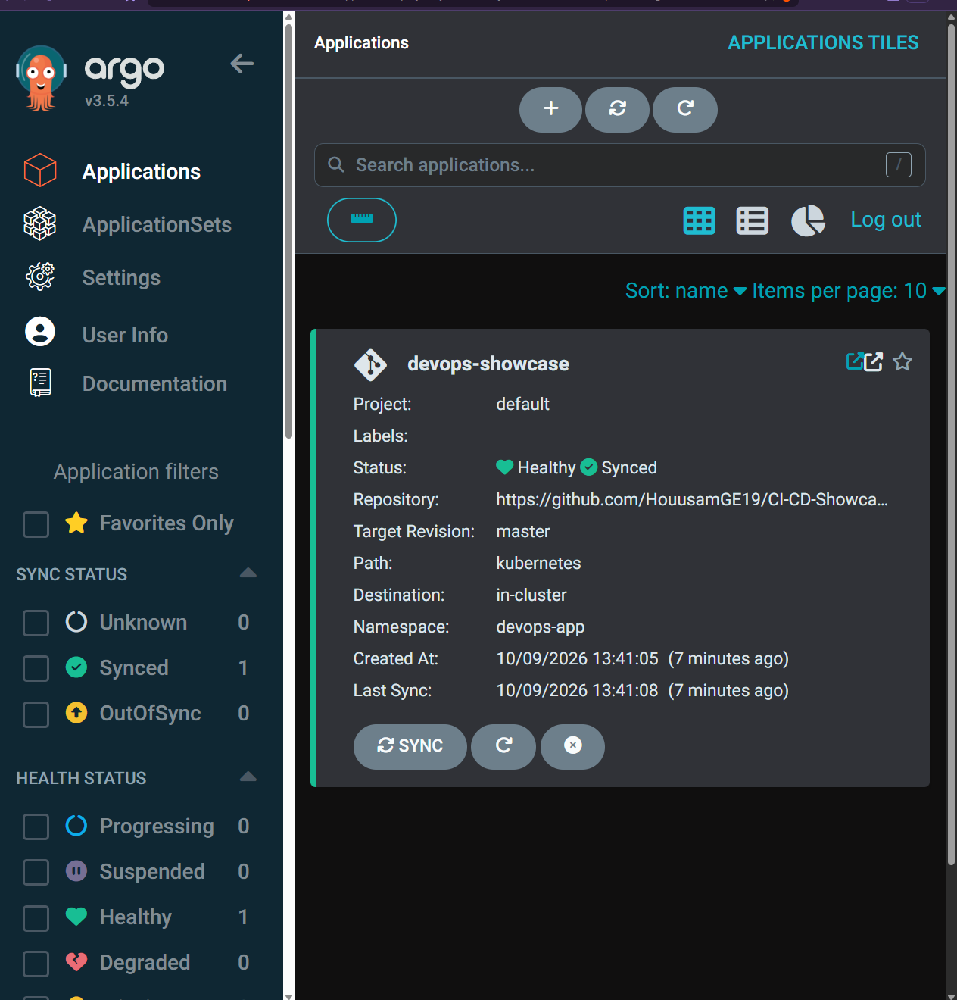
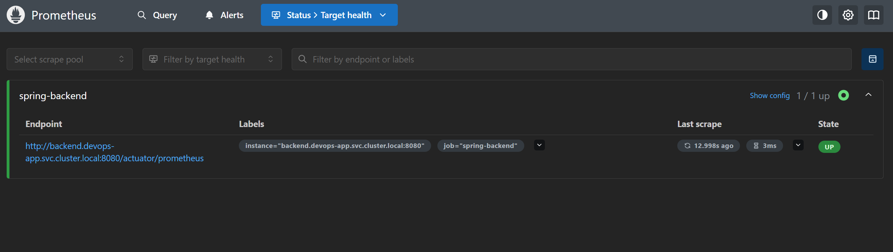
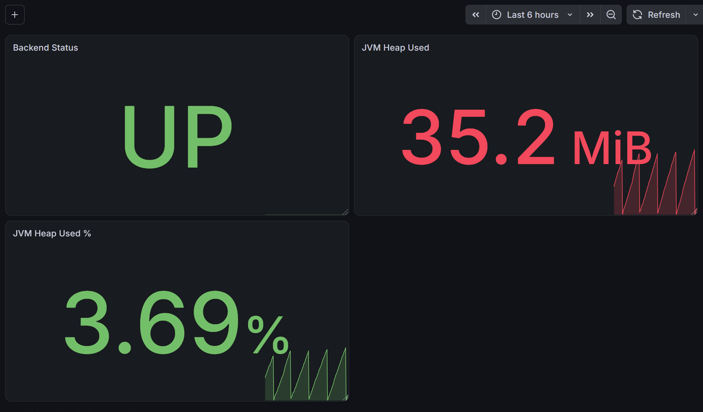
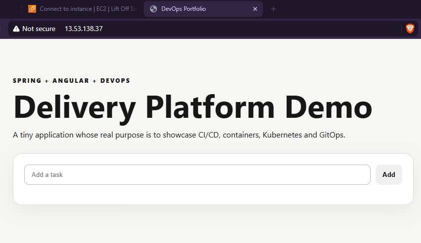

# CI/CD Showcase — Spring Boot + Angular GitOps Platform


A full-stack DevOps portfolio project that demonstrates a complete software-delivery path from source code to a monitored Kubernetes workload running on AWS.

The application itself is intentionally simple. The main focus is the platform around it: **CI, containerization, image security, GitOps, Kubernetes, cloud deployment, persistence, and observability**.

## Architecture



### End-to-end delivery flow

1. A developer pushes code to GitHub.
2. GitHub Actions builds and verifies the Java and Angular applications.
3. Docker images are built for the backend and frontend.
4. Trivy scans both images for HIGH and CRITICAL vulnerabilities.
5. Passing images are published to GitHub Container Registry (GHCR) with the exact Git commit SHA.
6. GitHub Actions updates `kubernetes/app.yaml` with those immutable image tags.
7. Argo CD detects the Git change and reconciles the Kubernetes cluster automatically.
8. k3s on AWS EC2 deploys the new version.
9. Spring Boot exposes Micrometer metrics through `/actuator/prometheus`.
10. Prometheus scrapes the metrics and Grafana visualizes application health and JVM behavior.

A failed Trivy security gate prevents the Kubernetes deployment manifest from being updated, so the vulnerable release is **not promoted by Argo CD**.

## What this project demonstrates

- **Continuous Integration** — Maven verification, Angular build, and container build automation.
- **Containerization** — Docker images for the Spring Boot backend and Angular/Nginx frontend.
- **Container Registry** — images published to GitHub Container Registry.
- **Immutable releases** — Kubernetes deploys images tagged with the exact Git SHA rather than relying on `latest`.
- **Security gating** — Trivy blocks deployment promotion when HIGH or CRITICAL vulnerabilities are found.
- **Kubernetes** — Deployments, Services, Ingress, health probes, Secrets, and persistent storage on k3s.
- **GitOps** — Argo CD uses Git as the desired-state source of truth and automatically self-heals the cluster.
- **AWS** — the Kubernetes node runs on an Ubuntu EC2 instance.
- **Observability** — Prometheus collects Spring Boot metrics and Grafana displays live application health and JVM metrics.

## Technology stack

| Area | Technology |
| --- | --- |
| Frontend | Angular, Nginx |
| Backend | Java 21, Spring Boot, Spring Data JPA, Actuator, Micrometer |
| Database | PostgreSQL 18 |
| Containers | Docker, Docker Compose |
| CI/CD | GitHub Actions |
| Registry | GitHub Container Registry (GHCR) |
| Security | Trivy |
| Orchestration | Kubernetes / k3s |
| GitOps | Argo CD |
| Cloud | AWS EC2 |
| Monitoring | Prometheus, Grafana |

# AWS Deployment

The production-style demo environment runs on a **single Ubuntu EC2 instance in AWS**. The instance hosts k3s and all Kubernetes workloads used by the project: the application, PostgreSQL, Argo CD, Prometheus, and Grafana.



The screenshot above captures the EC2 environment during the original provisioning stage. The project initially ran on a `t3.small`. As more platform services were added, especially Argo CD and monitoring, memory pressure became visible and the instance was later moved to a **4 GiB memory size** for a more stable lab environment.

## AWS setup

### Region and compute

- **AWS region:** `eu-north-1` (Stockholm)
- **Availability Zone shown during setup:** `eu-north-1c`
- **Service:** Amazon EC2
- **Operating system:** Ubuntu
- **Kubernetes distribution:** k3s
- **Storage:** 20 GiB gp3 EBS root volume
- **Cluster topology:** single-node k3s cluster

This is deliberately a compact lab architecture rather than a production multi-node Kubernetes design. It keeps the project affordable while still demonstrating the full DevOps lifecycle.

### EC2 security group

The instance was configured with a minimal inbound ruleset:

| Port | Purpose | Exposure |
| --- | --- | --- |
| `22/tcp` | SSH administration | Restricted to the developer's current public IP |
| `80/tcp` | Application HTTP traffic | Public |
| `443/tcp` | HTTPS / future TLS ingress | Public |

Administrative dashboards are **not directly exposed to the internet**. Argo CD, Prometheus, and Grafana are reached with Kubernetes port-forwarding combined with an SSH tunnel.

Example access pattern:

```text
Browser on developer machine
        ↓
localhost port
        ↓
SSH tunnel
        ↓
EC2 localhost
        ↓
kubectl port-forward
        ↓
Argo CD / Prometheus / Grafana
```

That keeps management interfaces private while still allowing secure access during development and demonstrations.

### SSH administration

The server is managed using an EC2 key pair:

```bash
ssh -i "devops-showcase-key.pem" ubuntu@<current-ec2-public-dns>
```

The SSH security-group rule is restricted to the current public IP rather than `0.0.0.0/0`.

Because the lab does not use an Elastic IP, the public IPv4 address / public DNS name can change after stopping and starting the instance.

### Installing k3s

k3s was installed directly on the EC2 host:

```bash
curl -sfL https://get.k3s.io | sh -
```

Cluster health can then be verified with:

```bash
sudo kubectl get nodes
sudo kubectl get pods -A
```

k3s was selected instead of EKS for this portfolio environment because it is lightweight and allows the project to demonstrate more hands-on platform work: Linux administration, Kubernetes installation, cluster troubleshooting, storage, ingress, networking, and resource management.

### Resource sizing and troubleshooting

The project intentionally went through a realistic sizing exercise. A smaller EC2 instance was sufficient for the application alone, but adding Argo CD increased memory pressure. Later, Prometheus and Grafana added additional resource consumption.

The cluster was monitored with:

```bash
free -h
sudo kubectl top nodes
sudo kubectl top pods -A --sort-by=memory
```

This led to increasing the lab instance to approximately **4 GiB of RAM**, providing enough headroom for the application and DevOps tooling to coexist on one node.

The monitoring workloads are also configured with CPU/memory limits so the observability stack cannot consume all available node resources.

### Why EC2 + k3s instead of EKS?

For this portfolio project, EC2 + k3s is intentional. A managed Kubernetes platform such as Amazon EKS would reduce the amount of cluster administration performed directly. Running k3s on EC2 makes the project demonstrate additional operational skills:

- Linux server administration
- SSH key management
- AWS security-group configuration
- Kubernetes installation and upgrades
- pod and node troubleshooting
- persistent-volume management
- ingress and service networking
- GitOps controller installation
- monitoring resource usage
- cost-conscious cloud architecture

This is a **learning/demo architecture**, not a claim that a single-node cluster should be used for highly available production workloads.

# CI/CD and GitOps

## Continuous Integration

GitHub Actions verifies the backend and frontend and builds the container images. Application changes trigger the pipeline automatically.

## Container publishing and security

Backend and frontend images are tagged with both `latest` and the immutable Git commit SHA.

Before a release is promoted, Trivy scans both images:

```text
Build image
   ↓
Trivy scan
   ↓
HIGH / CRITICAL vulnerability?
   ├── Yes → fail workflow, do not update Kubernetes manifest
   └── No  → continue deployment flow
```

The security gate was tested during development: vulnerable dependencies were detected, fixed, rebuilt, and rescanned before deployment was allowed to continue.

## GitOps deployment

After both images pass the scan, GitHub Actions updates the image references in `kubernetes/app.yaml` to the new commit SHA and commits that desired state back to Git.

Argo CD watches:

```text
Repository: HouusamGE19/CI-CD-Showcase
Branch:     master
Path:       kubernetes
Namespace:  devops-app
```

Automatic synchronization uses:

- `selfHeal: true`
- `prune: true`

This means Kubernetes configuration is driven from Git rather than manually applying deployment changes on the EC2 host.

## GitHub Actions evidence



# Kubernetes deployment

The application runs in the `devops-app` namespace and contains:

- PostgreSQL Deployment, Service, and persistent volume claim
- Spring Boot Deployment and Service
- Angular/Nginx Deployment and Service
- Ingress
- Spring Boot readiness probe

Database credentials are intentionally **not committed to Git**. They are created as a Kubernetes Secret before the first deployment:

```bash
kubectl create namespace devops-app
kubectl -n devops-app create secret generic postgres-secret \
  --from-literal=username='<username>' \
  --from-literal=password='<password>'
```

For this single-node demo environment, k3s uses its local-path storage provisioner for persistence.

# Argo CD

Argo CD continuously compares the live cluster with the manifests stored in Git.



A successful deployment reaches:

```text
Sync Status:   Synced
Health Status: Healthy
```

The GitOps flow was validated by changing Kubernetes configuration in Git without manually running `kubectl apply`; Argo CD detected the change and reconciled the cluster automatically.

# Monitoring and observability

Spring Boot exposes application metrics through:

```text
/actuator/prometheus
```

Prometheus scrapes the backend every 15 seconds, and Grafana uses Prometheus as its data source.

The monitoring stack tracks metrics such as:

- backend availability
- JVM heap memory
- JVM heap utilization percentage
- application CPU usage
- HTTP/application metrics exposed by Micrometer

Prometheus target health was validated through its API and reported the Spring backend as:

```text
health = up
lastError = ""
```
## Prometheus target health



Prometheus successfully scrapes the Spring Boot backend through
`/actuator/prometheus`. The `spring-backend` target is `UP`.

## Grafana dashboard



The dashboard includes live panels such as:

- **Backend Status** — Prometheus `up{job="spring-backend"}` mapped to `UP` / `DOWN`
- **JVM Heap Used** — current Java heap consumption
- **JVM Heap Used %** — percentage of available JVM heap in use

# Application

The sample application provides a small task interface. Its purpose is to provide a real workload around which the DevOps platform can be demonstrated.



## API

- `GET /api/tasks`
- `GET /api/tasks/{id}`
- `POST /api/tasks`
- `PUT /api/tasks/{id}`
- `DELETE /api/tasks/{id}`

Example request:

```json
{
  "title": "Build the CI pipeline",
  "completed": false
}
```

# Run locally

The full application can also be run locally with Docker Compose:

```bash
docker compose up --build
```

Open:

```text
http://localhost:8088
```

Stop the stack:

```bash
docker compose down
```

Remove the database volume as well:

```bash
docker compose down -v
```

# Repository layout

```text
.
├── .github/workflows/
│   ├── ci.yml
│   └── publish.yml
├── argocd/
│   └── application.yaml
├── backend/
│   ├── Dockerfile
│   ├── pom.xml
│   └── src/
├── docs/
│   └── screenshots/
│       ├── architecture.png
│       ├── application.png
│       ├── argocd.png
│       ├── aws-ec2.png
│       ├── github-actions.png
│       └── grafana.png
├── frontend/
│   ├── Dockerfile
│   ├── nginx.conf
│   └── src/
├── kubernetes/
│   └── app.yaml
├── monitoring/
│   ├── README.md
│   ├── grafana.yaml
│   └── prometheus.yaml
└── docker-compose.yml
```

# Security notes

- Kubernetes Secrets are not stored in the repository.
- SSH is restricted by AWS security-group source IP.
- Argo CD, Prometheus, and Grafana are not directly exposed publicly.
- Deployment images use immutable commit-SHA tags.
- HIGH and CRITICAL container vulnerabilities fail the Trivy security gate.
- PostgreSQL data is persisted with a Kubernetes persistent volume claim.

# What I learned

This project provided practical experience with:

- designing CI/CD workflows in GitHub Actions
- building and publishing Docker images
- using GHCR as a container registry
- implementing a container security gate with Trivy
- installing and operating Kubernetes with k3s
- deploying a full-stack application to AWS EC2
- configuring AWS networking and SSH access
- troubleshooting cloud VM resource constraints
- using immutable image versions for deployment traceability
- implementing GitOps with Argo CD
- configuring Kubernetes persistence and Secrets
- exposing Spring Boot metrics with Micrometer and Actuator
- collecting metrics with Prometheus
- building Grafana dashboards from live application telemetry

# Portfolio summary

This repository demonstrates more than application development. It shows the complete path from **source code → CI → security scanning → container registry → GitOps → Kubernetes on AWS → monitoring**.

The strongest parts of the project are the automated delivery chain, immutable deployments, security gating, hands-on AWS/k3s operation, Argo CD reconciliation, and live observability of the deployed Spring Boot workload.
